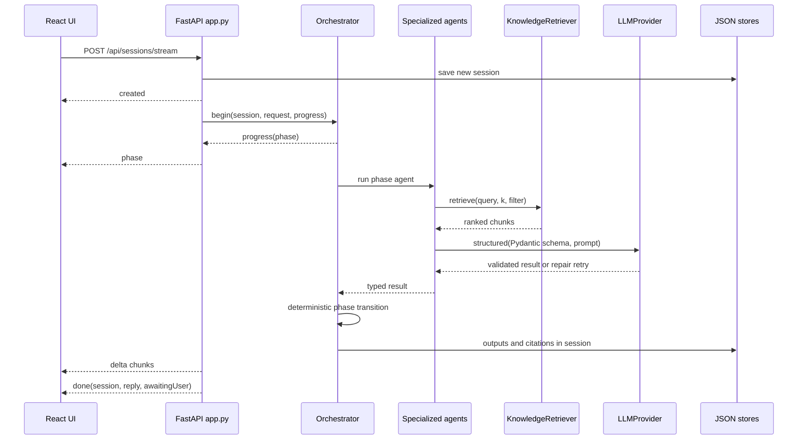
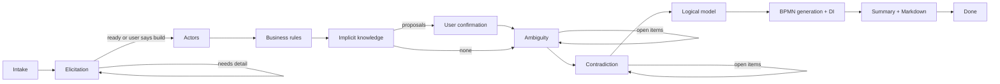
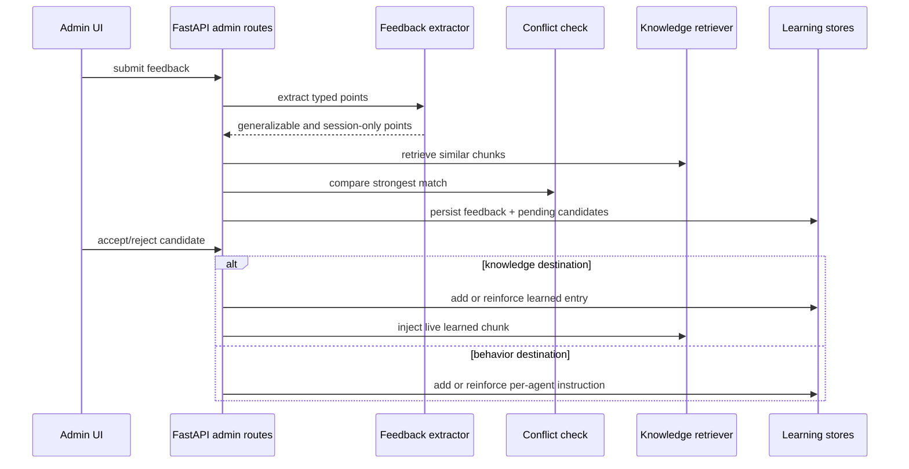
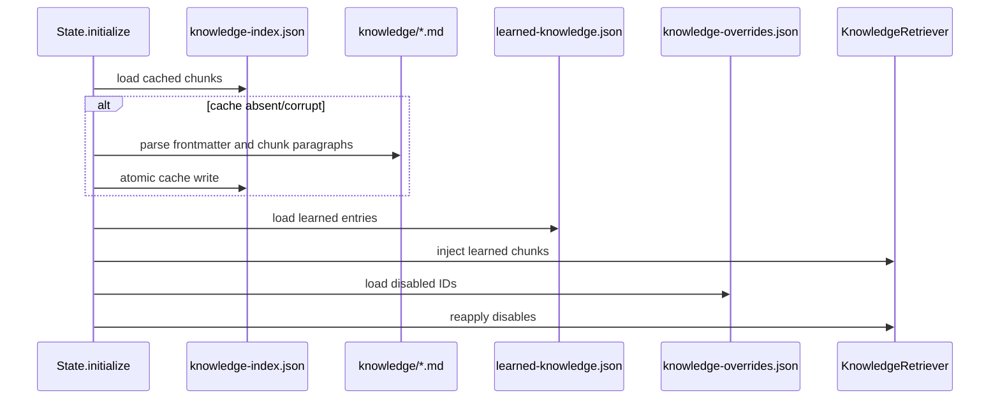

# Runtime sequences

## Streamed analysis turn

Failures after stream open emit `error` with persisted session. Client disconnect cancels in-flight
orchestration/provider work and keeps current session state. Non-stream JSON routes return status 502
with `{ "error": "..." }`; create also includes `sessionId`.

## Phase state machine

Each phase has a separate prompt and typed output under [agents](../bpmn_analyst/agents).
Coordinator code is [orchestrator.py](../bpmn_analyst/orchestrator.py).

## Feedback and learning

Correction learning first runs correction-diff agent, then feeds its generalizable description into
same feedback extraction/review queue. Answered admin questions use same path. Reviewed sessions can
also become few-shot examples or deterministic eval cases.

## Knowledge startup and use

Retrieval calls append JSONL telemetry. Admin knowledge dashboard aggregates citations, usefulness,
disabled state, source, and recurring low-score gaps.

## Code map

- Backend/API: [app.py](../bpmn_analyst/app.py)
- Schemas: [models.py](../bpmn_analyst/models.py)
- LLM providers: [llm.py](../bpmn_analyst/llm.py)
- Agents/prompts: [agents](../bpmn_analyst/agents)
- Orchestration: [orchestrator.py](../bpmn_analyst/orchestrator.py)
- Knowledge: [knowledge.py](../bpmn_analyst/knowledge.py)
- BPMN XML/DI/validation: [bpmn.py](../bpmn_analyst/bpmn.py)
- Outputs/evals: [output.py](../bpmn_analyst/output.py), [eval.py](../bpmn_analyst/eval.py)
- Persistence: [stores.py](../bpmn_analyst/stores.py)
- Frontend stream client: [api.ts](../packages/web/src/api.ts)
