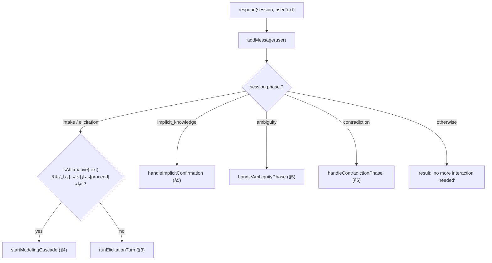
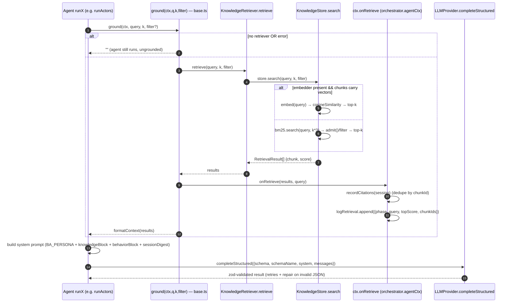

# Request → Response — Pipeline Sequence Diagrams

> A function-level trace of **one user turn**, from the browser to the streamed
> reply, across every branch the orchestrator can take. Every box names a real
> function so you can jump straight into the code. Companion to
> [TECHNICAL.md](TECHNICAL.md) §8 (agents & orchestration) and §11 (server).
>
> Mermaid diagrams render in the VS Code markdown preview and on GitHub.

---

## 0. The players (call stack, top → bottom)

| Layer | File | Key functions |
|---|---|---|
| Browser | `web/src/App.tsx`, `web/src/api.ts` | `api.streamCreate` / `api.streamMessage` → `streamSSE` → `dispatchSSE` → `onCreated`/`onPhase`/`onDelta`/`onDone`/`onError` |
| HTTP route | `server/src/routes.ts` | `POST /api/sessions/stream`, `POST /api/sessions/:id/messages/stream` |
| SSE envelope | `server/src/routes.ts` | `runStreamingTurn` → `sseOpen`, `sseSend`, `streamReplyText`, `llmError` |
| Coordinator | `core/src/agents/orchestrator.ts` | `begin`, `respond`, `agentCtx`, phase handlers |
| Agents | `core/src/agents/*.ts` | `runElicitation`, `runActors`, `runBusinessRules`, `runImplicit`, `runAmbiguity`, `runContradiction`, `runLogicalModel` |
| RAG + LLM | `core/src/agents/base.ts`, `knowledge/*`, `llm/*` | `ground` → `retriever.retrieve` → `store.search`; `llm.completeStructured` |
| Finalize | `core/src/output/finalize.ts`, `bpmn/*` | `produceOutputs` → `validateModel`, `generateBpmn`, `buildProcessSummary`, `buildFinalDocument` |
| Persistence | `core/src/state/store.ts` | `FileSessionStore.save` / `.get` |

There is **one LLM call per agent run**. During elicitation a turn runs one agent;
at the modeling hand-off a turn runs a short cascade of agents (see §4–§5).

---

## 1. The transport envelope (same for every streaming turn)

This wrapper is identical whether the turn is a first request or a follow-up — only
the `run` closure differs (`begin` vs `respond`). The interesting work happens inside
`run(onProgress)`, expanded in the scenario diagrams below.

```mermaid
sequenceDiagram
  autonumber
  participant U as Browser (App.tsx)
  participant API as api.ts (streamSSE)
  participant R as routes.ts
  participant ST as runStreamingTurn
  participant O as Orchestrator
  participant SS as FileSessionStore

  U->>API: api.streamCreate(request, handlers)
  API->>R: POST /api/sessions/stream {request}
  R->>R: session = newSession(uuid); session.request = request
  R->>ST: runStreamingTurn(res, ctx, session, run)
  ST->>ST: sseOpen(res)  (hijack + SSE headers)
  ST->>SS: store.save(session)
  ST-->>API: event: created {session}
  API-->>U: onCreated(session)  (reconcile optimistic bubble)

  ST->>O: run(onProgress) = orchestrator.begin(session, request, onProgress)
  O-->>ST: onProgress(phase)  (per setPhase)
  ST-->>API: event: phase {phase}
  API-->>U: onPhase(phase)
  Note over O: agents run here — see §3–§5

  O-->>ST: TurnResult {reply, awaitingUser, session, processModel?}
  ST->>SS: store.save(turn.session)
  ST->>ST: streamReplyText(reply)  (word-by-word, ~18ms)
  ST-->>API: event: delta {text} …
  API-->>U: onDelta(text)
  ST-->>API: event: done {session, reply, awaitingUser}
  API-->>U: onDone(...)

  Note over ST: on throw → event: error {llmError(err)} ; finally res.raw.end()
```

**Non-streaming variants** (`POST /api/sessions`, `POST /api/sessions/:id/messages`)
skip the SSE machinery: they just `await ctx.orchestrator.begin/respond`, `store.save`,
and return `view(session, reply, awaitingUser)` as plain JSON. Same orchestrator calls,
no `phase`/`delta` events.

---

## 2. Turn dispatch — which handler runs (`Orchestrator.respond`)

A follow-up message is routed purely by the **stored phase** on the session. This is
the whole branch logic of a turn.



`begin()` is the special case: it seeds `request`, `setPhase(elicitation)`, adds the
user message, and calls `runElicitationTurn` directly (equivalent to the top branch).

---

## 3. Inner loop — every agent run (`ground()` + `completeStructured`)

Every `runX` agent shares this shape. This is where RAG grounding, **citation
recording**, **retrieval telemetry**, and the LLM call happen. (Ambiguity is the one
agent that skips `ground` entirely.)



> The logical-model agent adds one step before the LLM call:
> `ctx.exampleBank.findSimilar(request, 1, session.id)` → folds a `modelDigest` of the
> closest admin-approved example into the prompt (few-shot).

---

## Scenario A — First request that still needs clarification

Endpoint `POST /api/sessions/stream` → `begin` → `runElicitationTurn`. The agent
extracts requirements and asks up to 3 questions; the turn **stops and waits**.

```mermaid
sequenceDiagram
  autonumber
  participant O as Orchestrator.begin
  participant ET as runElicitationTurn
  participant EA as runElicitation (elicitation.ts)

  O->>O: setPhase(elicitation) → onProgress; addMessage(user, request)
  O->>ET: runElicitationTurn(ctx, session)
  ET->>EA: runElicitation(ctx, session)
  Note over EA: ground(k=3) + completeStructured  (see §3)
  EA-->>ET: {extractedRequirements, questions, assistantMessage, readyToModel}
  ET->>ET: push requirements (source=user, confirmed=true)
  ET->>ET: session.openQuestions = questions
  alt readyToModel && questions.length == 0
    ET->>O: startModelingCascade  (§4)
  else
    ET->>ET: reply = assistantMessage + bullet(questions)
    ET-->>O: result(reply, awaitingUser=true)  ⟵ STOP, wait for user
  end
```

**Scenario A′ — follow-up answer, still eliciting.** Next message hits
`/messages/stream` → `respond` (phase `elicitation`, not affirmative) → same
`runElicitationTurn`. Loops here until `readyToModel` or the user approves (Scenario B).

---

## Scenario B — User approves modeling → the cascade

Trigger: `respond` sees `isAffirmative` + a build keyword (or `runElicitationTurn`
reports `readyToModel`). Runs `actors → business_rules → implicit_knowledge` back to
back — **three agent runs in one turn**.

```mermaid
sequenceDiagram
  autonumber
  participant O as startModelingCascade
  participant A1 as runActors
  participant A2 as runBusinessRules
  participant A3 as runImplicit

  O->>O: setPhase(actors) → onProgress
  O->>A1: runActors(ctx, session)  [RAG filter: kind ∈ glossary/domain]
  A1-->>O: roles[]  → dedupe by name → session.roles

  O->>O: setPhase(business_rules)
  O->>A2: runBusinessRules(ctx, session)
  A2-->>O: rules[]  → session.businessRules (explicit, confirmed=true)

  O->>O: setPhase(implicit_knowledge)
  O->>A3: runImplicit(ctx, session)  [RAG k=5]
  A3-->>O: implicitRules[]  → session.businessRules (implicit, confirmed=FALSE)

  alt implicit rules proposed
    O-->>O: reply "confirm these?"; result(awaitingUser=true)  ⟵ STOP
  else none proposed
    O->>O: handleAmbiguityPhase  (§5)
  end
```

(Each `runActors`/`runBusinessRules`/`runImplicit` internally follows §3.)

---

## Scenario C — Confirmation gates → finalize

After the cascade the pipeline walks three gates. Each gate re-runs its detection
agent; if it finds open items it **stops and waits**, otherwise it advances. The
resume path (a user answering a gate) re-enters via `respond` at the stored phase.

```mermaid
sequenceDiagram
  autonumber
  participant O as Orchestrator
  participant IC as handleImplicitConfirmation
  participant AM as runAmbiguity
  participant CO as runContradiction
  participant LM as runLogicalModel
  participant OUT as produceOutputs

  Note over O,IC: entry after "confirm implicit?" — respond(phase=implicit_knowledge)
  O->>IC: handleImplicitConfirmation(userText)
  alt isAffirmative
    IC->>IC: mark all implicit rules confirmed=true
  else
    IC->>IC: acknowledge (keep as-is)
  end

  IC->>AM: setPhase(ambiguity) → runAmbiguity(ctx, session)
  AM-->>O: ambiguities[]
  alt open ambiguities (non-empty description)
    O-->>O: store status=open; reply questions; awaitingUser=true  ⟵ STOP
  else none
    O->>CO: setPhase(contradiction) → runContradiction(ctx, session)
    CO-->>O: contradictions[]
    alt open contradictions
      O-->>O: store status=open; reply + suggestedResolution; awaitingUser=true  ⟵ STOP
    else none
      O->>LM: setPhase(logical_model) → runLogicalModel  [maxTokens 8000, retries 3, few-shot]
      LM-->>O: ProcessModel → session.processModel
      O->>OUT: setPhase(bpmn_generation) → produceOutputs(session)
      OUT->>OUT: validateModel(model)
      OUT->>OUT: generateBpmn = toBpmnXml + layoutProcess (falls back to semantic-only)
      OUT->>OUT: buildProcessSummary + buildFinalDocument
      OUT-->>O: {bpmnXml, validation, summary, document} → session.outputs
      O->>O: setPhase(done)
      O-->>O: reply counts + validity; result(awaitingUser=false, processModel)
    end
  end
```

**Resume note.** When a gate stops (`awaitingUser=true`), the user's next message
lands on `/messages/stream` → `respond` → the same phase handler
(`handleAmbiguityPhase` / `handleContradictionPhase`). The handler **re-runs the
detection agent** with the new answer folded in via `recentChat` + `sessionDigest`;
if the agent now returns an empty array, the gate opens and the pipeline advances.

---

## Scenario map (user action → code entry)

| # | User action | Endpoint | Entry | Path | Ends turn? |
|---|---|---|---|---|---|
| A | Send first request | `POST /sessions/stream` | `begin` → `runElicitationTurn` | §A + §3 | waits (questions) |
| A′ | Answer a question | `POST /:id/messages/stream` | `respond`(elicitation) → `runElicitationTurn` | §A + §3 | waits or → B |
| B | "بساز / proceed" | `POST /:id/messages/stream` | `respond` → `startModelingCascade` | §B (+§3 ×3) | waits (confirm implicit) or → C |
| — | (auto) `readyToModel` | any | `runElicitationTurn` → `startModelingCascade` | §B | as B |
| C1 | Confirm implicit rules | `POST /:id/messages/stream` | `respond`(implicit_knowledge) → `handleImplicitConfirmation` | §C | waits (ambiguity/contradiction) or finalizes |
| C2 | Resolve an ambiguity | `POST /:id/messages/stream` | `respond`(ambiguity) → `handleAmbiguityPhase` | §C | waits or advances |
| C3 | Resolve a contradiction | `POST /:id/messages/stream` | `respond`(contradiction) → `handleContradictionPhase` | §C | waits or → finalize |
| — | (auto) all gates clear | — | `buildLogicalModel` → `produceOutputs` | §C tail | `done` (returns model) |

---

## Function reference index (jump list)

- Web: [`web/src/api.ts`](../packages/web/src/api.ts) — `streamSSE`, `dispatchSSE`, `api.streamCreate`, `api.streamMessage`
- Routes: [`server/src/routes.ts`](../packages/server/src/routes.ts) — `registerRoutes`, `runStreamingTurn`, `sseOpen`, `sseSend`, `streamReplyText`, `llmError`
- Orchestrator: [`core/src/agents/orchestrator.ts`](../packages/core/src/agents/orchestrator.ts) — `begin`, `respond`, `agentCtx`, `runElicitationTurn`, `startModelingCascade`, `handleImplicitConfirmation`, `handleAmbiguityPhase`, `handleContradictionPhase`, `buildLogicalModel`, `setPhase`, `recordCitations`, `isAffirmative`
- Base: [`core/src/agents/base.ts`](../packages/core/src/agents/base.ts) — `ground`, `knowledgeBlock`, `behaviorBlock`, `sessionDigest`, `genId`, `BA_PERSONA`
- Agents: [`elicitation.ts`](../packages/core/src/agents/elicitation.ts) `runElicitation` · [`actors.ts`](../packages/core/src/agents/actors.ts) `runActors` · [`business-rules.ts`](../packages/core/src/agents/business-rules.ts) `runBusinessRules` · [`implicit.ts`](../packages/core/src/agents/implicit.ts) `runImplicit` · [`ambiguity.ts`](../packages/core/src/agents/ambiguity.ts) `runAmbiguity` · [`contradiction.ts`](../packages/core/src/agents/contradiction.ts) `runContradiction` · [`logical-model.ts`](../packages/core/src/agents/logical-model.ts) `runLogicalModel`
- RAG: [`knowledge/retriever.ts`](../packages/core/src/knowledge/retriever.ts) `retrieve` · [`knowledge/store.ts`](../packages/core/src/knowledge/store.ts) `search` · [`knowledge/bm25.ts`](../packages/core/src/knowledge/bm25.ts) `search`
- Finalize: [`output/finalize.ts`](../packages/core/src/output/finalize.ts) `produceOutputs` · [`bpmn/validator.ts`](../packages/core/src/bpmn/validator.ts) `validateModel` · [`bpmn/layout.ts`](../packages/core/src/bpmn/layout.ts) `generateBpmn`
- Persistence: [`state/store.ts`](../packages/core/src/state/store.ts) `FileSessionStore`
- Wiring: [`server/src/app.ts`](../packages/server/src/app.ts) `buildApp` (builds `ctx`, injects `exampleBank`/`behavior`/`logRetrieval`)
